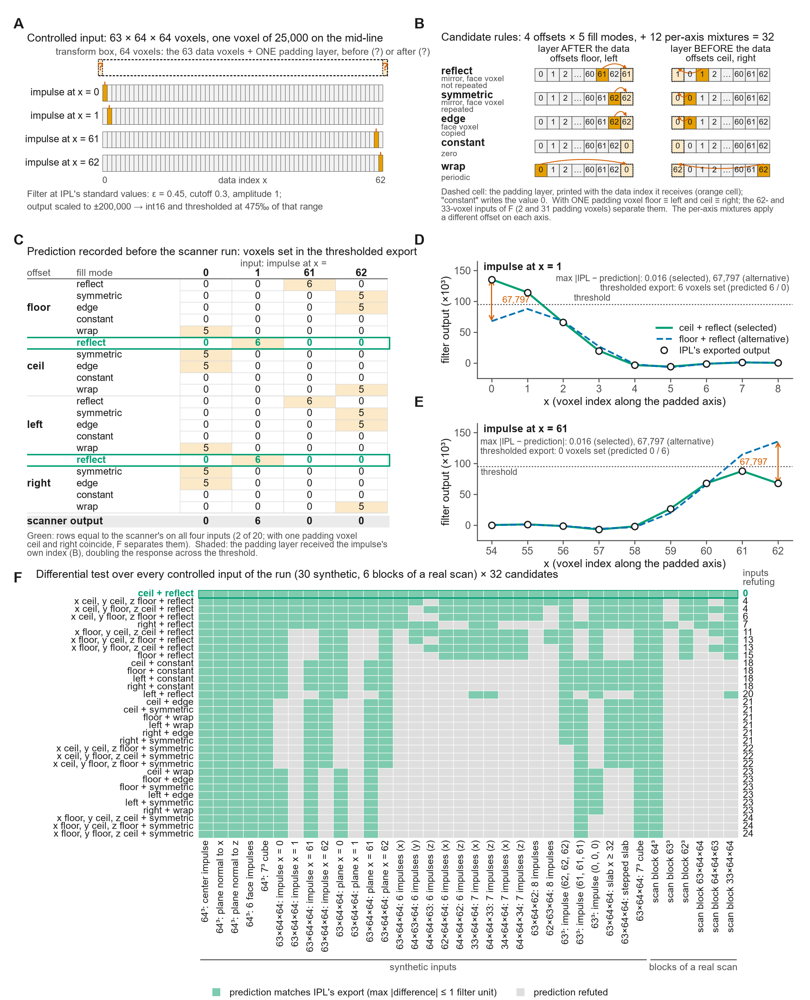

# How the reimplementation was derived

The package was written without access to IPL's source code, and no part of IPL was decompiled or disassembled. Each operation was derived from published and vendor-supplied material and fixed by experiment on the scanner: a black-box form of reverse engineering in the taxonomy of Chikofsky and Cross (1990), with differential testing against the reference implementation (McKeeman 1998) as the acceptance criterion.

## Sources

The published algorithms: the Laplace–Hamming segmentation of Laib and Rüegsegger (1999), the sphere-fitting thickness of Hildebrand and Rüegsegger (1997), the chamfer distance transforms of Borgefors (1986), and the dual-threshold contour of Buie et al. (2007); the IPL command documentation and the on-screen help of each command (Scanco Medical AG 2015); the manufacturer's evaluation scripts supplied with the scanner, which fix the command sequence and every parameter value; the processing log IPL embeds in every output file, which records the commands and options that produced it; and IPL's exported intermediate products.

## Method

Every operation was written as a candidate rule and tested on controlled inputs: synthetic phantoms constructed so that competing rules predict different outputs, and real scans evaluated on the scanner with one option varied at a time. For each test run the output each candidate predicted was recorded before the scanner was run, and a rule was accepted only when IPL's exported product matched its prediction voxel for voxel (to within one filter unit for the floating-point filter output); otherwise it was revised and the test run repeated. Once a stage was fixed, the implementation was tested differentially against IPL's exports at every later stage, so that a departure was located where it first appeared. [Figure D8](figures.md#figure-d8), reproduced below, gives one worked test run, the padding rule of the Laplace–Hamming filter: the inputs, the candidates, the predictions recorded before the run, and IPL's export. The approach, reimplementation validated by agreement with IPL's output, is that of ORMIR-XCT (Kuczynski et al. 2024) and of the ORMIR guidelines (Bonaretti et al. 2026), and has been applied to a vendor's closed reconstruction in micro-CT (Wiegmann and Ford 2026); here it is carried to the voxel.

## A worked example: the padding rule of the Laplace–Hamming filter

**Figure D8.** The derivation method on one rule: the padding of IPL's Laplace–Hamming filter, which pads every axis to the next power of two before the transform; the question is on which side of the data an odd padding puts its extra voxel and what fills it. (A) The controlled input: a synthetic 63 × 64 × 64 volume, all zero except one voxel of 25,000 on the mid-line, in four versions with the impulse at x = 0, 1, 61 and 62; the transform box is 64 wide, so exactly one padding layer is added on x, before or after the data, filled by an unknown rule. The filter runs at IPL's standard values (ε = 0.45, cutoff 0.3, amplitude 1), scaled to ±200,000 → int16 and thresholded at 475‰. (B) The candidate rules: 4 offsets (where the layer goes) × 5 fill modes (what it contains), 20 uniform candidates plus 12 per-axis mixtures, 32 in all; each cell shows which data index the padding layer receives. A candidate that copies the impulse's own index doubles the response and drives the thresholded export above zero. (C) The prediction table recorded before the scanner run: for every candidate, the number of voxels set in the thresholded export of each of the four inputs, with the scanner's own output in the last row; two of the 20 uniform candidates (green) equal it on all four inputs, and with one padding voxel the offsets ceil and right coincide. (D, E) The float-level readout for the impulse at x = 1 and at x = 61: IPL's exported filter output along the mid-line against the prediction of the selected rule (maximum difference 0.016 units) and of the rejected alternative floor + reflect (67,797 units, on the other side of the threshold). (F) The same differential test over every controlled input of the run (30 synthetic volumes and 6 blocks cut from a real scan) for all 32 candidates: a cell is green when the candidate's predicted filter output differs from IPL's exported output by at most one filter unit at every voxel and gray when it does not; one candidate (ceil + reflect: the extra voxel before the data, filled by the edge-exclusive mirror) matches on 36 of 36, and every other candidate is refuted by at least 4 inputs.

## Scans used in the derivation

Part of the derivation used scans of the validation set: patellae for most stages (all 21 patellae for the contour rendering), and two tibiae for the pore cascade ([Figure D9I](figures.md#figure-d9)). On those scans, agreement with IPL is not an independent test of the reimplementation.

## References

- Bonaretti S, Barzegari M, Bevers M, et al. (2026). Open and reproducible research in musculoskeletal imaging: why it matters and how to implement it with the guidelines of the ORMIR community. JBMR Plus 10(4): ziag025. doi:10.1093/jbmrpl/ziag025.
- Borgefors G (1986). Distance transformations in digital images. Comput Vis Graph Image Process 34(3): 344–371. doi:10.1016/S0734-189X(86)80047-0.
- Buie HR, Campbell GM, Klinck RJ, MacNeil JA, Boyd SK (2007). Automatic segmentation of cortical and trabecular compartments based on a dual threshold technique for in vivo micro-CT bone analysis. Bone 41(4): 505–515. doi:10.1016/j.bone.2007.07.007.
- Chikofsky EJ, Cross JH (1990). Reverse engineering and design recovery: a taxonomy. IEEE Softw 7(1): 13–17. doi:10.1109/52.43044.
- Hildebrand T, Rüegsegger P (1997). A new method for the model-independent assessment of thickness in three-dimensional images. J Microsc 185(1): 67–75. doi:10.1046/j.1365-2818.1997.1340694.x.
- Kuczynski MT, Neeteson NJ, Stok KS, et al. (2024). ORMIR_XCT: a Python package for high resolution peripheral quantitative computed tomography image processing. J Open Source Softw 9(97): 6084. doi:10.21105/joss.06084.
- Laib A, Rüegsegger P (1999). Comparison of structure extraction methods for in vivo trabecular bone measurements. Comput Med Imaging Graph 23(2): 69–74. doi:10.1016/S0895-6111(98)00071-8.
- McKeeman WM (1998). Differential testing for software. Digit Tech J 10(1): 100–107.
- Scanco Medical AG (2015). XtremeCT II User's Guide, version 2.6. Brüttisellen, Switzerland: Scanco Medical AG.
- Wiegmann FL, Ford NL (2026). Benchmarking open-source FDK against commercial and iterative reconstruction methods for preclinical micro-CBCT. arXiv preprint, posted April 24, 2026. doi:10.48550/arXiv.2604.23047.
