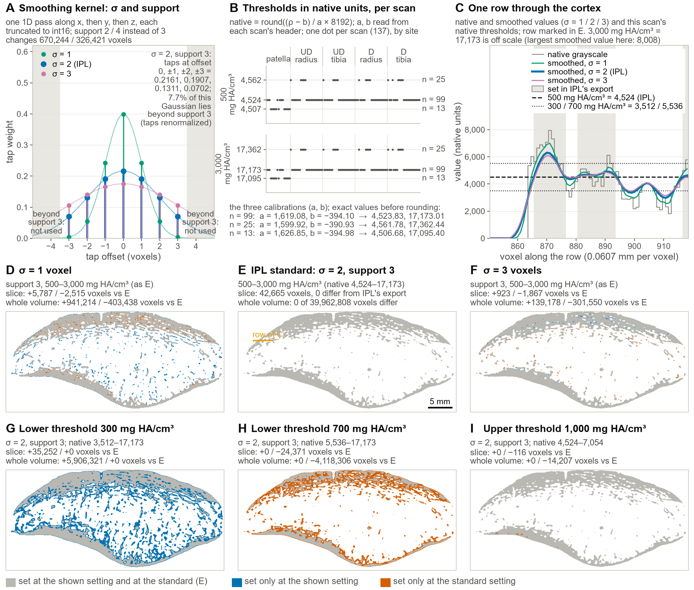
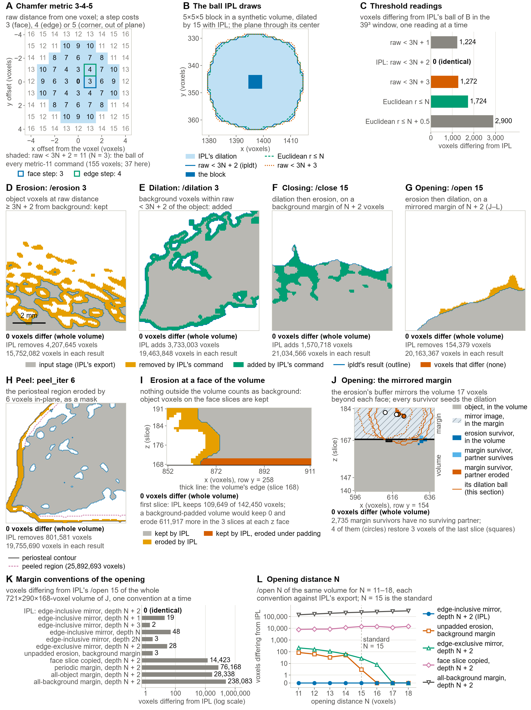
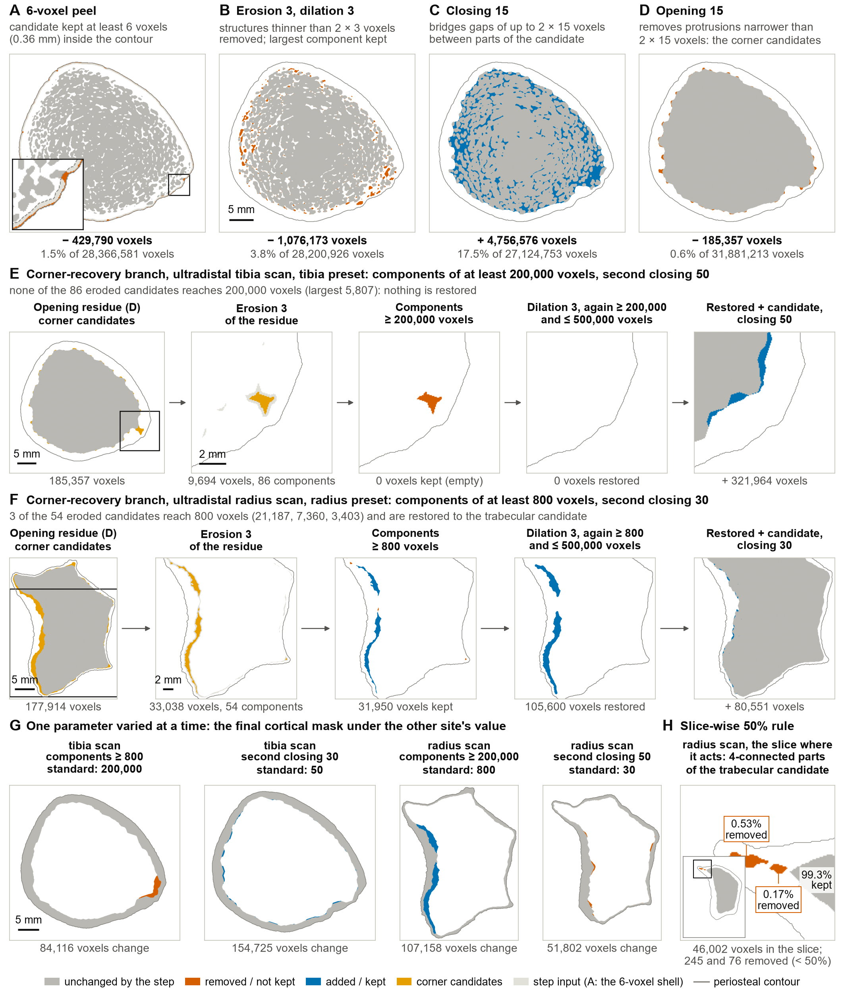
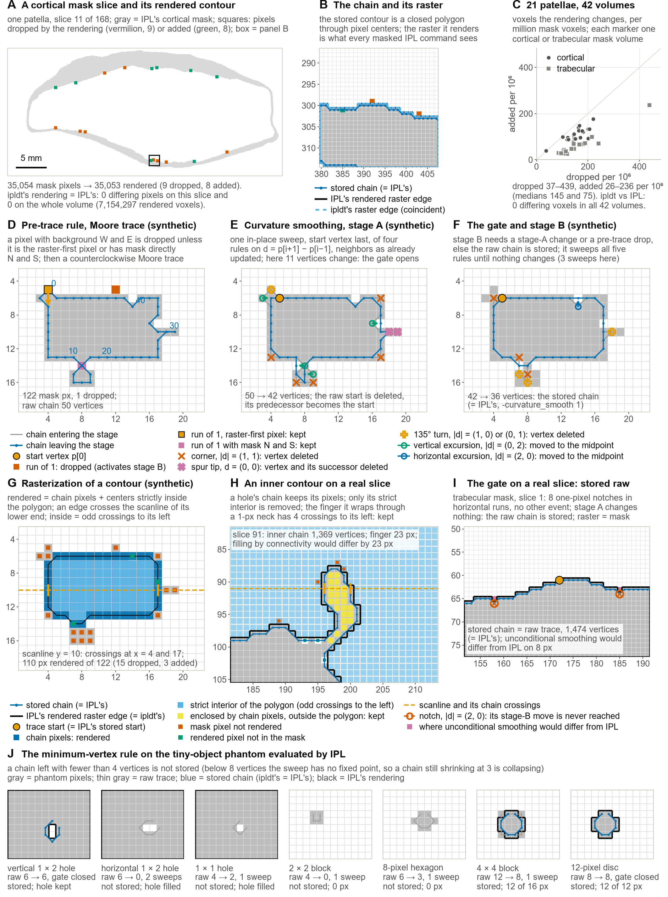
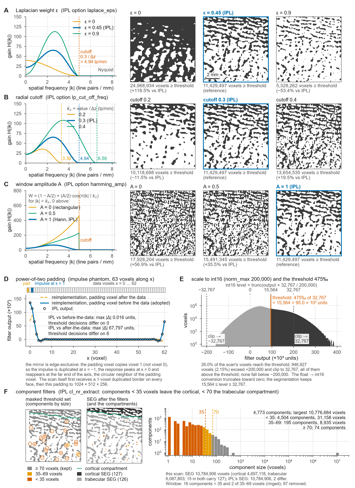
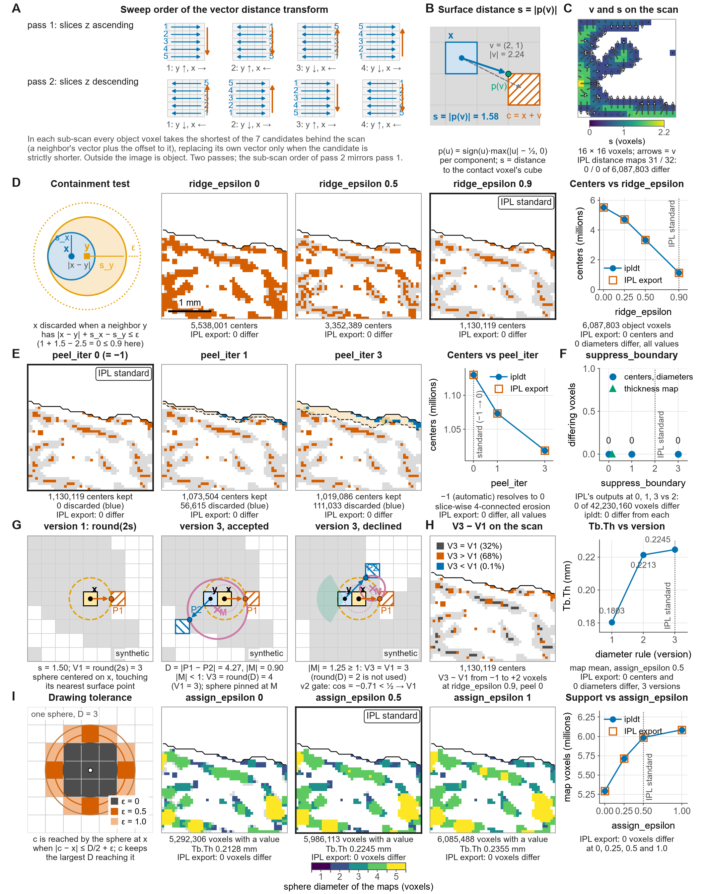
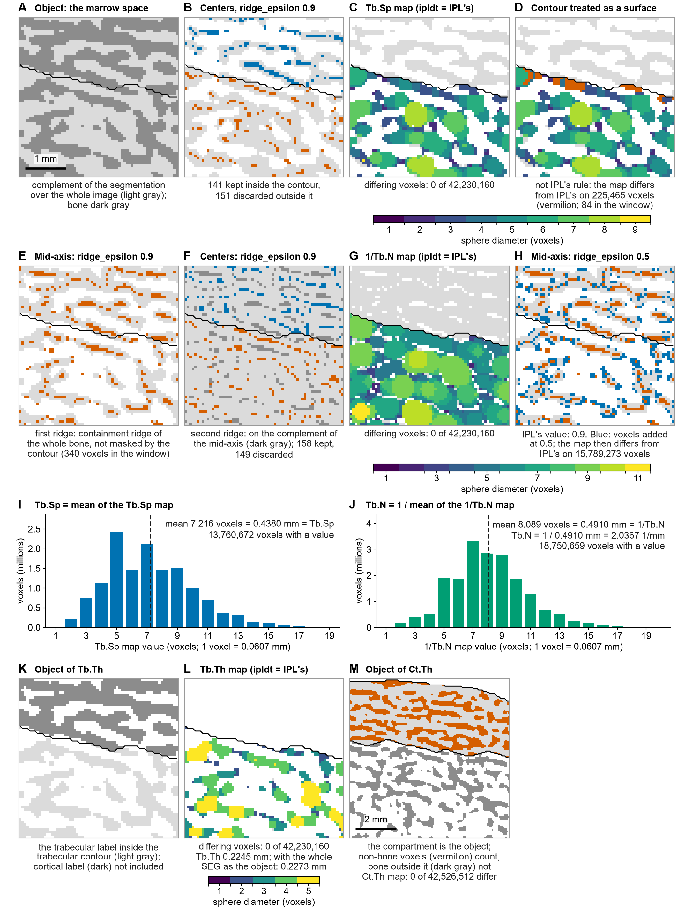
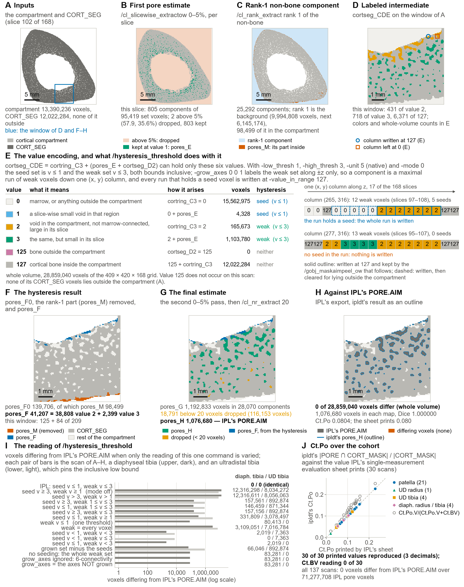

# Documentation figures D1–D9 (the parameter atlas)

Documentation Figures D1–D7 and D9 form an atlas of the package's parameters, one panel per parameter or rule (the distance-transform engine takes two figures, D6 and D7), each showing what that parameter does on real data or, where clearer, on a small synthetic example; Figure D8 shows the derivation method on one rule; the [parameter table](../manuscript/tables/tableS1_parameters.md) lists every parameter with the panel that shows it. IPL V5.42 is the reference throughout, and every count of differing voxels is computed from IPL's exported volumes and the package's results. The stages the figures belong to are described in [How ipldt reimplements the IPL evaluation, stage by stage](implementation.md), which links to each panel, and the derivation method of Figure D8 in [How the reimplementation was derived](derivation.md). References to Figures 1–6 are to the main figures of the paper, which are kept in [`manuscript/figures/`](../manuscript/figures/); the image files of the documentation figures are in [`manuscript/figures/supp/`](../manuscript/figures/supp/).

Figure numbers in these pages follow the figure files of `manuscript/figures/` (`fig1_workflow` … `fig6_porosity`); in the published paper, `fig3_lh` is Supplementary Figure S1 and `fig4_dt`, `fig5_agreement`, and `fig6_porosity` are Figures 3, 4, and 5.

## Contents

- [Figure D1](#figure-d1). The dense-bone estimate (IPL /seg_gauss) and what each of its parameters controls
- [Figure D2](#figure-d2). The chamfer-metric morphology of IPL (-metric 11) as ipldt reimplements it
- [Figure D3](#figure-d3). The compartment chain (STEP 1) parameter by parameter, and the two site presets
- [Figure D4](#figure-d4). Contour rendering: mask to contour object, curvature smoothing, rasterization, minimum-vertex rule
- [Figure D5](#figure-d5). The Laplace–Hamming segmentation (STEP 2), one panel per parameter or rule
- [Figure D6](#figure-d6). The parameters of the distance-transform engine (/dt_thickness, /dt_spacing, /dt_number)
- [Figure D7](#figure-d7). dt_spacing and dt_number, the map statistics, and the objects of the two thickness maps
- [Figure D8](#figure-d8). The derivation method on one rule: the padding of the Laplace–Hamming filter
- [Figure D9](#figure-d9). The cortical pore cascade (/hysteresis_threshold and the two slice-wise passes) stage by stage, and Ct.Po

## Figure D1. The dense-bone estimate (IPL /seg_gauss) and what each of its parameters controls

**Figure D1.** The dense-bone estimate (IPL /seg_gauss), the first stage of the compartment separation, and what each of its parameters controls, on the patella scan of Figure 2 (XtremeCT II, 60.7 µm). (A) The smoothing kernel: the taps of the separable Gaussian at σ = 1, 2 (IPL's standard) and 3 voxels with support 3, renormalized over the taps within the support; the shaded offsets beyond the support are not used (7.7% of the σ = 2 Gaussian lies beyond support 3). A one-dimensional pass is run along x, then y, then z, each truncated to int16; support 2 or 4 instead of 3 changes 670,244 or 326,421 voxels (6,926,948 dense voxels at the standard; the smaller valid grid of support 4 holds 6,838,533 of them). (B) The two density thresholds, 500 and 3,000 mg HA/cm³, converted to native units through the calibration in each scan's header, native = round((ρ − b) / a × 8192), with the density slope a and intercept b of the scan's calibration, one dot per scan (137, by site: 21 patellae and 29 each of ultradistal radius, ultradistal tibia, diaphyseal radius and diaphyseal tibia; UD, ultradistal; D, diaphyseal); the three calibrations of the cohort, on 13, 99 and 25 scans, give 4,507, 4,524 and 4,562 for the lower and 17,095, 17,173 and 17,362 for the upper threshold. (C) One grayscale row through the cortex (marked in E): the native values, the smoothed values at σ = 1, 2 and 3, this scan's native thresholds and, shaded, the voxels set in IPL's own export of the stage. (D–F) The stage on the same slice at σ = 1, 2 and 3 with the standard thresholds; (G–I) at σ = 2 with the lower threshold at 300 or 700 mg HA/cm³ and with the upper threshold at 1,000 mg HA/cm³. In D–I gray marks voxels set at the shown setting and at the standard, blue voxels set only at the shown setting and vermilion voxels set only at the standard; the counts give the differences on the slice and over the whole volume. At the standard setting (E) ipldt's stage is identical to IPL's export (0 of 39,962,808 voxels differ). Scale bar 5 mm.

## Figure D2. The chamfer-metric morphology of IPL (-metric 11) as ipldt reimplements it

**Figure D2.** The chamfer-metric morphology of IPL (-metric 11) as ipldt reimplements it. (A) The chamfer 3-4-5 metric: the raw distance of every voxel of a 9 × 9 grid to the central voxel (a step costs 3 across a face, 4 across an edge and 5 across a corner) and, shaded, the ball raw < 3N + 2 that every metric-11 command uses (N = 3: 155 voxels, 37 in this plane). (B) The ball IPL draws: an isolated 5 × 5 × 5 block of a synthetic volume dilated by 15 with IPL, the plane through the block center, with the outline of the reimplemented ball (raw < 3N + 2) and of the raw < 3N + 3 and Euclidean alternatives. (C) The five threshold readings of B against IPL's export: voxels differing in the 39³ window, 0 for raw < 3N + 2 and 1,224 to 2,900 for the others. (D–G) /erosion 3, /dilation 3, /close 15 and /open 15, the standard distances of the compartment separation, on one window of the mid slice of a patella scan (scale bar 2 mm): the input stage (IPL's export, gray), the voxels IPL's command removes (orange) or adds (green), ipldt's result as a blue outline and, below, the whole-volume comparison (0 differing voxels for each command). (H) The 6-voxel contour peel (/gobj_maskaimpeel_ow -peel_iter 6): the periosteal region eroded by 6 voxels in-plane and applied as a mask (0 differing voxels). (I) The erosion at a face of the volume (an x–z section through the first slices): nothing outside the volume counts as background, so object voxels on the face slices are kept; a background-padded volume would erode 611,917 more voxels in the three slices at each z face. (J) The mirrored margin of the opening on a second patella scan (an x–z section through the last slices): the erosion's buffer mirrors the volume 17 voxels (N + 2) beyond each face and every erosion survivor, those in the margin included, seeds the dilation; 2,735 margin survivors have no surviving partner in the volume, and four of them restore three voxels of the last slice. (K) Eleven margin conventions against IPL's /open 15 of the whole 721 × 290 × 168-voxel volume of J, one at a time: only the edge-inclusive mirror of depth N + 2 gives an opening identical to IPL's; the others differ by 2 to 238,083 voxels. (L) /open N of the same volume for N = 11 to 18 under five of the conventions, each against IPL's export; N = 15 is the standard.

## Figure D3. The compartment chain (STEP 1) parameter by parameter, and the two site presets

**Figure D3.** The compartment chain (STEP 1) parameter by parameter on real data, and the two site presets side by side. Two scans of the validation set, each under IPL's standard preset for its site: an ultradistal tibia (tibia preset: corner components of at least 200,000 voxels, second closing 50) and an ultradistal radius (radius preset: at least 800 voxels, closing 30). Every panel is a real slice; the voxel counts under the images are whole-volume counts of the same run. (A–D) The morphological steps of the trabecular candidate on the tibia scan: the 6-voxel peel, which keeps the candidate at least 0.36 mm (6 voxels) inside the periosteal contour; erosion 3 and dilation 3, which remove structures thinner than 2 × 3 voxels and keep the largest component; closing 15, which bridges gaps of up to 2 × 15 voxels; and opening 15, which removes protrusions narrower than 2 × 15 voxels, the corner candidates (gray, unchanged; vermilion, removed; blue, added; scale bar 5 mm). (E) The corner-recovery branch on the tibia scan under the tibia preset: the opening residue, its erosion by 3, the components of at least 200,000 voxels, the dilation by 3 with the bounds 200,000 to 500,000 voxels applied again, and the restored voxels added to the candidate before the second closing (50); none of the 86 eroded candidates of this scan reaches 200,000 voxels (largest 5,807), so nothing is restored. (F) The same branch on the radius scan under the radius preset: 3 of the 54 eroded candidates reach 800 voxels and 105,600 voxels are restored before the closing by 30. (G) One parameter varied at a time: the change of the final cortical mask when the other site's value is used for the corner-component threshold or the second closing distance (84,116 and 154,725 voxels on the tibia scan; 107,158 and 51,802 on the radius scan). (H) The slice-wise 50% rule on the radius scan, on the slice where it acts: the 4-connected components of the trabecular candidate with their share of the slice's set voxels; two components (0.53% and 0.17%) are removed and the component holding 99.3% is kept.

## Figure D4. Contour rendering: mask to contour object, curvature smoothing, rasterization, minimum-vertex rule

**Figure D4.** Contour rendering: what /togobj_from_aim -curvature_smooth 1 (mask to contour object) followed by /gobj_to_aim (contour to raster) does, rule by rule, and where a rendered contour differs from the mask it came from. (A) One cortical-mask slice of a patella (slice 11 of 168; gray, IPL's mask): the pixels the rendering drops (vermilion, 9) and adds (green, 8); 35,054 mask pixels render as 35,053, and ipldt's rendering is identical to IPL's on this slice and on the whole volume (0 of 7,154,297 rendered voxels differ). Scale bar 5 mm. (B) Zoom of the box in A: the stored chain, a closed polygon through pixel centers, and the raster edge it renders (IPL's and ipldt's coincide). (C) The 21 patellae, cortical and trabecular masks (42 volumes): voxels dropped and added by the rendering per million mask voxels (dropped 37 to 439, added 26 to 236 per 10⁶); ipldt's rendering differs from IPL's in 0 voxels in every volume. (D–G) The rules on a 20 × 24-pixel synthetic slice that exercises all of them. (D) The pre-trace rule, by which a pixel with background to the west and east is dropped unless it is the raster-first pixel of its component or has mask directly above and below, and the counterclockwise Moore trace (122 mask pixels, 1 dropped; raw chain of 50 vertices). (E) Curvature smoothing, stage A: one in-place sweep of four vertex rules (corner, spur, 135° turn, vertical excursion; 50 → 42 vertices). (F) The gate and stage B: whenever stage A or the pre-trace rule changed the chain, all five rules (with the horizontal excursion) are swept until a sweep changes nothing (42 → 36 vertices in three sweeps; the stored chain equals IPL's). (G) Rasterization: the chain pixels plus the pixel centers strictly inside the polygon by the even-odd scanline rule (110 pixels rendered from the 122 mask pixels: 15 dropped, 3 added). (H) An inner contour on a real cortical slice: a hole's chain keeps its pixels and only its strict interior is removed; a finger enclosed by chain pixels but outside the polygon is kept, as IPL keeps it. (I) The gate on a real trabecular slice: eight one-pixel notches in horizontal runs and no other event, so stage A changes nothing, the raw chain is stored (1,474 vertices, equal to IPL's) and the raster is identical to the mask; unconditional smoothing would differ from IPL on 8 pixels. (J) The minimum-vertex rule on the tiny-object phantom evaluated by IPL: a chain left with fewer than 4 vertices is not stored (no contour, nothing rendered); a raw chain the gate leaves untouched has at least 4 vertices and is therefore always stored; thresholds 4 to 6 render identically, and 7 or 8 would also drop the 6-vertex raw chain of the vertical 1 × 2 hole and fill the hole that IPL keeps. Gray, phantom pixels; thin gray, raw trace; blue, stored chain (ipldt's = IPL's); black, IPL's rendering.

## Figure D5. The Laplace–Hamming segmentation (STEP 2), one panel per parameter or rule

**Figure D5.** The Laplace–Hamming segmentation (STEP 2), one panel per parameter or rule, on the patella scan of Figure 3B (150 × 150-voxel windows, 9.1 mm; scale bar 2 mm) except the padding phantom (D). (A) The Laplacian weight ε (IPL option laplace_eps): the transfer function H(|k|) for ε = 0, 0.45 (IPL) and 0.9, and the thresholded response of one slice under each value (voxels at or above the threshold over the whole scan: +118.5% and −53.4% relative to IPL's value). (B) The radial cutoff (lp_cut_off_freq), in units of 1/Δz: 0.2, 0.3 (IPL) and 0.4, that is 3.30, 4.94 and 6.59 line pairs/mm (−11.5% and +19.5%). (C) The window amplitude (hamming_amp): 0 (rectangular), 0.5 and 1 (Hann, IPL) (+56.9% and +35.5%). (D) The power-of-two padding on an impulse phantom of 63 voxels along x, so that exactly one padding voxel is added: IPL's own filter output along the mid-line against the reimplementation with the padding voxel before the data (the package's rule; maximum difference 0.016 units, 0 threshold decisions differ) and after it (67,797 units, 6 decisions differ); the mirror is edge-exclusive, so the padding voxel copies voxel 1. (E) Scaling to int16 (/norm_max 200,000) and the threshold: the distribution of the float filter output of the scan, the level trunc(output × 32,767 / 200,000) with clipping at ±200,000, and the lower threshold 475‰ of 32,767 = 15,564; 26.0% of the scan's voxels reach the threshold. (F) The component filters (/cl_nr_extract): 6-connected components of the masked threshold set smaller than 35 voxels leave both compartments and those of 35 to 69 voxels leave the trabecular compartment only (4,773 components on this scan: 4,504 below 35 voxels and 195 of 35 to 69); the SEG that results, with the cortical (127) and trabecular (126) labels, has 10,784,906 voxels, and IPL's SEG of the same scan differs from it on 2 voxels.

## Figure D6. The parameters of the distance-transform engine (/dt_thickness, /dt_spacing, /dt_number)

**Figure D6.** The parameters of the distance-transform engine (/dt_thickness, /dt_spacing, /dt_number), one panel per parameter or rule. Real-data panels use one patella scan: the object is IPL's trabecular segmentation (6,087,803 voxels), the region of interest is IPL's trabecular contour rendered by ipldt, and the window is that of Figure 4 (scale bar 1 mm); the counts are whole-scan counts, each compared with IPL's own export at the same parameter value. (A) The sweep order of the vector distance transform: two passes over the slices, four boustrophedon sub-scans per slice, the sub-scan order of the second pass mirroring the first; in each sub-scan every object voxel takes the shortest of the seven candidates behind the scan, and outside the image counts as object. (B) The surface distance s = |p(v)|, with p(u) = sign(u) · max(|u| − ½, 0) per component: the distance to the cube of the contact voxel. (C) The vectors v and s on the scan (16 × 16 voxels); IPL's exported distance maps (-metric 31, floor(s + ½), and -metric 32, rint(|v|)) differ from ipldt's on 0 of 6,087,803 object voxels. (D) ridge_epsilon: the containment test (a voxel x is discarded when a neighbor y has |x − y| + s_x − s_y ≤ ε), the centers kept at ε = 0, 0.5 and 0.9 (IPL's standard) and the number of centers against ε, plotted at ε = 0, 0.25, 0.5 and 0.9 (5,538,001, 3,352,389 and 1,130,119 at the three shown; IPL's export differs on 0 at each value). (E) peel_iter: the rendered contour eroded 0 (= −1, automatic), 1 and 3 times, the centers the peel discards (0, 56,615 and 111,033) and the count against peel_iter; the map is clipped to the unpeeled contour. (F) suppress_boundary: IPL's outputs at 0, 1 and 3 differ from those at 2 on 0 of 42,230,160 voxels, and ipldt differs from each on 0. (G) The diameter rule (-version) on a synthetic phantom: version 1 rounds 2s; version 3 accepts a sphere pinned between the contact point of x and that of its neighbor one step against the surface direction when the midpoint lies within one voxel (|M| < 1) and otherwise falls back to version 1; the cone gate of version 2 is shown for the declined case. (H) Version 3 against version 1 at the 1,130,119 centers of the scan (V3 > V1 at 68% of them, differences of −1 to +2 voxels) and Tb.Th under the three versions (0.1803, 0.2213 and 0.2245 mm); IPL's export differs on 0 centers and 0 diameters for all three. (I) assign_epsilon: the drawing tolerance (a voxel c is reached by the sphere at x when |c − x| ≤ D/2 + ε and keeps the largest D reaching it), the map at ε = 0, 0.5 (IPL) and 1.0 and the map support against ε, plotted at ε = 0, 0.25, 0.5 and 1.0 (5,292,306, 5,986,113 and 6,085,488 voxels at the three shown; Tb.Th 0.2128, 0.2245 and 0.2355 mm; IPL's export differs on 0 voxels at each value). Color bar: sphere diameter in voxels.

## Figure D7. dt_spacing and dt_number, the map statistics, and the objects of the two thickness maps

**Figure D7.** dt_spacing and dt_number: what the two complement-based distance transforms do that dt_thickness does not, on one 64 × 64-voxel window of one slice of a patella scan (the window of Figure 4 enlarged; scale bar 1 mm), with every parameter at IPL's standard value (ridge_epsilon 0.9, assign_epsilon 0.5, peel_iter −1, version 3), and two rule variations with IPL's rule marked. (A–D) dt_spacing (Tb.Sp): (A) the object is the marrow space, the complement of the bone segmentation over the whole image (light gray; bone dark gray), and the trabecular contour (black line) is not a surface; (B) its containment ridge, with the centers kept inside the contour (141 in the window, vermilion) and discarded outside it (151, blue); (C) the Tb.Sp map, clipped to the contour, identical to IPL's (0 of 42,230,160 voxels differ); (D) the same map if the contour were treated as a surface (object = marrow inside the contour), which is not IPL's rule: the map then differs from IPL's on 225,465 voxels (vermilion; 84 in the window). (E–H) dt_number (1/Tb.N): (E) the first ridge, the containment ridge of the whole bone segmentation at ridge_epsilon 0.9 (the mid-axis), computed on the whole bone, cortex included, and not masked by the contour; (F) the second ridge, the containment ridge of the complement of the mid-axis, again at 0.9, with the centers kept inside the contour (158) and discarded (149); (G) the 1/Tb.N map, identical to IPL's (0 of 42,230,160 voxels differ); (H) the first ridge at ridge_epsilon 0.5 instead of 0.9 (blue, the voxels it adds to the mid-axis): the map then differs from IPL's on 15,789,273 voxels. (I, J) The statistics over the whole scan: the distribution of the Tb.Sp map's values, whose mean (7.216 voxels = 0.4380 mm) is Tb.Sp, and of the 1/Tb.N map's values, whose mean (8.089 voxels = 0.4910 mm) is 1/Tb.N and whose reciprocal is Tb.N (2.0367 1/mm). (K–M) The objects of the two thickness maps. (K) The object of Tb.Th in IPL's evaluation script, used for the comparison with IPL: the trabecular label of the segmentation inside the trabecular contour (light gray); the cortical label (dark gray) is not part of it. (L) Its Tb.Th map, identical to IPL's (0 of 42,230,160 voxels differ); Tb.Th of this scan is 0.2245 mm, and 0.2273 mm when the whole segmentation is taken as the object, as the ORMIR-BQRL workflow does (Figure 4A). (M) The object of Ct.Th, in a window twice the size at the cortex (scale bar 2 mm): the cortical compartment mask inside the cortical contour (light gray), whose non-bone voxels (vermilion; 2,457,003 of the 7,154,580 compartment voxels of this scan, the pores and every other void of the compartment) are object voxels too, whereas the bone outside the compartment (dark gray) is not; the Ct.Th map is identical to IPL's (0 of 42,526,512 voxels differ). Color bars: sphere diameter in voxels.

## Figure D8. The derivation method on one rule: the padding of the Laplace–Hamming filter

**Figure D8.** The derivation method ([How the reimplementation was derived](derivation.md)) on one rule: the padding of IPL's Laplace–Hamming filter, which pads every axis to the next power of two before the transform; the question is on which side of the data an odd padding puts its extra voxel and what fills it. (A) The controlled input: a synthetic 63 × 64 × 64 volume, all zero except one voxel of 25,000 on the mid-line, in four versions with the impulse at x = 0, 1, 61 and 62; the transform box is 64 wide, so exactly one padding layer is added on x, before or after the data, filled by an unknown rule. The filter runs at IPL's standard values (ε = 0.45, cutoff 0.3, amplitude 1), scaled to ±200,000 → int16 and thresholded at 475‰. (B) The candidate rules: 4 offsets (where the layer goes) × 5 fill modes (what it contains), 20 uniform candidates plus 12 per-axis mixtures, 32 in all; each cell shows which data index the padding layer receives. A candidate that copies the impulse's own index doubles the response and drives the thresholded export above zero. (C) The prediction table recorded before the scanner run: for every candidate, the number of voxels set in the thresholded export of each of the four inputs, with the scanner's own output in the last row; two of the 20 uniform candidates (green) equal it on all four inputs, and with one padding voxel the offsets ceil and right coincide. (D, E) The float-level readout for the impulse at x = 1 and at x = 61: IPL's exported filter output along the mid-line against the prediction of the selected rule (maximum difference 0.016 units) and of the rejected alternative floor + reflect (67,797 units, on the other side of the threshold). (F) The same differential test over every controlled input of the run (30 synthetic volumes and 6 blocks cut from a real scan) for all 32 candidates: a cell is green when the candidate's predicted filter output differs from IPL's exported output by at most one filter unit at every voxel and gray when it does not; one candidate (ceil + reflect: the extra voxel before the data, filled by the edge-exclusive mirror) matches on 36 of 36, and every other candidate is refuted by at least 4 inputs.

## Figure D9. The cortical pore cascade (/hysteresis_threshold and the two slice-wise passes) stage by stage, and Ct.Po

**Figure D9.** IPL's cortical pore cascade — the block of the evaluation script that implements the method of Burghardt et al. (2010) and writes `<base>_PORE.AIM` — as ipldt reimplements it, stage by stage on one diaphyseal tibia of the validation set, the scan of Figure 6A (XtremeCT II, 60.7 µm, 409 × 420 × 168 = 28,859,040 voxels; slice 102 of 168). A diaphysis is shown rather than a patella because the hysteresis contributes nothing on a patella: pores_F comes out empty on all 21 patellae of the validation set, which hold no voxel of value 2 (and 14,642 to 323,956 of value 3), so a patella exercises the rest of the cascade only. Counts under the images are whole-volume counts of the same run. (A) The two inputs: IPL's rendered cortical compartment (/gobj_to_aim of the CORT_MASK contour file, 13,390,236 voxels) and the cortical segmentation CORT_SEG inside it (12,022,284 voxels, none of them outside the compartment); the blue box is the 100 × 100-voxel window of D and F–H. Scale bar 5 mm. (B) The first pore estimate: CORT_SEG inverted, its 4-connected components taken slice by slice, and /cl_slicewise_extractow 0–5%, which keeps at value 1 every component holding at most 5% of that slice's set voxels; this slice has 805 components over 95,419 set voxels, the two above the bound (57.9 and 35.6%) are dropped and 803 are kept, and pores_E holds 1,108,108 voxels over the volume. (C) The rank-1 non-bone component: /cl_rank_extract -first_rank 1 -last_rank 1 -connect_boundary false applied to "everything that is not cortical bone" (16,836,756 voxels in 25,292 components); rank 1 is the background outside the bone (9,994,808 voxels; the medullary cavity is the next largest, 6,145,174), and the /gobj_maskaimpeel_ow -peel_iter 0 that follows keeps as pores_M the 98,499 of it that lie inside the compartment, which are then subtracted from the compartment label. (D) The labeled intermediate cortseg_CDE = cortring_C3 + (pores_E + cortseg_D2) on the window, one color per value (431 voxels of value 2, 718 of value 3 and 6,371 of value 127 in this window); the marked voxels are the two columns drawn in E. Scale bar 1 mm, as in F–H. (E) The value encoding, which is what the cascade's arithmetic exists for, and the rule of /hysteresis_threshold. The label image can hold only six values, and their whole-volume counts on this scan are 15,562,975 at 0 (marrow, or anything outside the compartment), 4,328 at 1 (a slice-wise small void in that region), 165,673 at 2 (a void inside the compartment that is not marrow-connected and is large in its slice), 1,103,780 at 3 (the same, and small in its slice), 0 at 125 (bone outside the compartment, which this scan has none of) and 12,022,284 at 127 (cortical bone). With -low_thresh 1, -high_thresh 3, -unit 5 (native) and -mode 0 the seed set is v ≤ 1 and the weak set v ≤ 3, both bounds inclusive; -grow_axes 0 0 1 labels the weak set along ±z only, so a component is a maximal run of weak voxels down one (x, y) column, and every run that contains at least one seed voxel is written at -value_in_range 127 (15,608,510 voxels before the compartment mask). The two strips are real columns of the scan: at (x, y) = (265, 316) the weak run of 12 voxels (slices 97–108) contains 5 seed voxels and is written, and the /gobj_maskaimpeel_ow that follows keeps the 7 of them that lie inside the compartment (solid outline) and clears the 5 that do not (dashed); at (277, 316) the weak run of 13 voxels (slices 95–107), 9 of value 2 and 4 of value 3, contains no seed and nothing is written. (F) The hysteresis result: pores_F0 is 139,706 voxels inside the compartment, of which the 98,499 of pores_M are removed by /subtract_aims, leaving pores_F, the 41,207 voxels the hysteresis contributes — 38,808 of value 2 and 2,399 of value 3 (209 = 125 + 84 in this window). (G) The final estimate: the second slice-wise 0–5% pass, run on the inverse of CORT_SEG with pores_F added to the bone, keeps the voids that are small in their slice (pores_DF, 1,151,626 voxels); pores_G, their union with pores_F, is 1,192,833 voxels in 28,070 6-connected components, and /cl_nr_extract -min_number 20 drops the 18,791 components below 20 voxels (116,153 voxels), leaving pores_H with 1,076,680 voxels. (H) pores_H against IPL's own exported PORE.AIM of the same measurement: 1,076,680 voxels in each map, 0 of 28,859,040 voxels differ, Dice 1.000000; Ct.Po is 1,076,680 / 13,390,236 = 0.0804 and IPL's evaluation sheet prints 0.080. (I) The reading of /hysteresis_threshold: the accepted reading and fifteen refuted candidates, each run with the rest of the cascade unchanged and compared voxel for voxel with IPL's PORE.AIM, on the scan of A–H, a diaphyseal tibia (upper bar of each pair), and on a second scan, an ultradistal tibia that is not the scan of Figure 6B (lower bar); the column of counts at the right is headed diaph. tibia / UD tibia (diaph., diaphyseal; UD, ultradistal). The two scans are complementary — the diaphyseal tibia carries 165,673 voxels of value 2 and 4,328 of value 1, whereas the ultradistal tibia carries 1,280,518 of value 1 and none of value 2 — and between them every alternative is refuted: the accepted reading differs on 0 voxels of both, while each refuted candidate differs on at least 2,019 voxels of one of the two and by up to 12,316,611. Two candidates put the bone value 127 into both the seed and the weak set, so the hysteresis returns the cortex itself (12,316,298 and 12,316,611 voxels differ on the scan of A–H); four leave the marrow out of the set the hysteresis returns, so the /subtract_aims that follows writes −127 — a set voxel in IPL's char arithmetic — over the unselected marrow and those voxels survive into the written map (146,459 to 331,809 voxels on that scan); taking either bound as strict costs 2,019 voxels on the diaphyseal tibia (the high bound) or 7,363 on the ultradistal tibia (the low bound); reading a single threshold costs 80,413 voxels on the diaphyseal tibia, dropping the upper bound 3,109,051, and returning the grown set without its seeds 66,046 on the diaphyseal tibia and 892,874 on the ultradistal tibia; and ignoring -grow_axes, reading it as the axes not to grow along, or dropping the seeding altogether each cost 83,281 voxels on the diaphyseal tibia. (J) Ct.Po over the cohort: ipldt's |PORE ∩ CORT_MASK| / |CORT_MASK| (configuration A, at full precision) against the value IPL's evaluation sheet prints, for the 30 scans whose evaluation sheet prints Ct.Po: 21 patellae and 9 radius or tibia scans (1 ultradistal radius, 4 ultradistal tibiae, 1 diaphyseal radius and 3 diaphyseal tibiae). Markers use the cohort colors of Figures 3, 5 and 6 and the cohort marker shapes of Figures 5 and 6 (UD, ultradistal; diaph., diaphyseal). The compartment reading reproduces the printed three decimals on all 30 sheets. The alternative Ct.Po.V / (Ct.Po.V + Ct.BV), with Ct.Po.V = |IPL's PORE.AIM| and Ct.BV = |CORT_SEG| (open circles), reproduces 0 of them. Over the whole validation set ipldt reproduces IPL's PORE.AIM with 0 differing voxels on all 137 scans, 71,277,708 IPL pore voxels in total. Of the 137 maps, 79 land on IPL's own grid; on the other 58, IPL's PORE.AIM box is offset, or sized differently, by one voxel in x, y or both, but the pore voxels are identical in global coordinates.

## References

- Burghardt AJ, Buie HR, Laib A, Majumdar S, Boyd SK (2010). Reproducibility of direct quantitative measures of cortical bone microarchitecture of the distal radius and tibia by HR-pQCT. Bone 47(3): 519–528. doi:10.1016/j.bone.2010.05.034.
